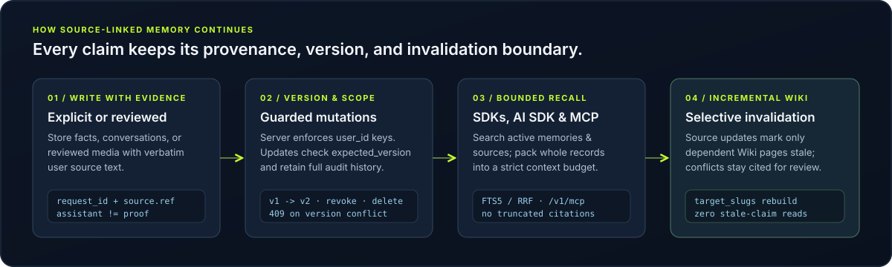

<p align="center">
  
</p>

<h1 align="center">SixteenMemory</h1>

<p align="center">
  <strong>Source-linked memory infrastructure for AI Agents. Context that continues.</strong><br>
  Retain verified facts and conversations, trace every claim to its source, assemble bounded context, and serve incremental knowledge over SDKs and MCP.
</p>

<p align="center">
  <a href="docs/QUICKSTART.md">Quickstart</a> ·
  <a href="docs/ARCHITECTURE.md">Architecture</a> ·
  <a href="product/sdk/README.md">TypeScript / JS SDK</a> ·
  <a href="product/sdk-python/README.md">Python SDK</a> ·
  <a href="product/integrations/vercel-ai/README.md">Vercel AI SDK</a> ·
  <a href="product/integrations/code-agents/README.md">MCP &amp; Code Agents</a> ·
  <a href="docs/ROADMAP.md">Roadmap</a> ·
  <a href="LICENSE">Apache-2.0</a>
</p>

---

## Why SixteenMemory?

Most agent memory layers treat retrieved snippets as unverified truth, silently overwrite conflicting statements, or require operating separate vector and graph databases before storing a single record. SixteenMemory is built around four explicit guarantees:

- **No claim without a source.** Every memory stores verbatim source evidence (`conversation`, `manual`, or reviewed media) alongside an idempotent `request_id`. An assistant's statement alone never proves a business action occurred.
- **Server-enforced scope and version control.** User isolation (`user_id`), read-only vs. read/write API keys, and OAuth PKCE grants are enforced in the Worker, never left to prompt instructions. Mutations require `expected_version` and preserve full audit history; deactivation excludes a record from recall while deletion purges online storage and indexes.
- **Incremental source-linked Wiki.** Derived knowledge pages record exact `(source_id, version)` dependencies. Editing or revoking a source marks only dependent Wiki pages stale—never leaking outdated claims into agent context and keeping multi-source conflicts visible for human review ([details](product/INCREMENTAL_WIKI_2026-11-23.md)).
- **Zero-model baseline, opt-in intelligence.** Runs out of the box on a Cloudflare Worker + SQLite Durable Object with built-in FTS5 lexical search—no external vector database, graph server, or paid LLM API key required. Enable fact extraction, Qwen semantic/hybrid RRF retrieval, or 30-minute audio/video ingestion only when needed.

<p align="center">
  
</p>

## Ecosystem at a glance

| Surface | Path | Description |
| :--- | :--- | :--- |
| **Memory &amp; Knowledge API** | [`product/worker/`](product/worker/) | Cloudflare Worker + SQLite Durable Object: versioned memories, evidence search, bounded context, conversations, incremental Wiki, and `/v1/mcp` |
| **Management Console** | [`product/src/`](product/src/) | React workspace to inspect memories, sources, version history, Wiki review candidates, conflicts, scoped keys, and request audit logs |
| **TypeScript / JS SDK** | [`product/sdk/`](product/sdk/) | Zero-runtime-dependency ESM client (`@sixteen-memory/sdk`) with OpenAPI-generated types, async iterators, and bounded transport |
| **Python SDK** | [`product/sdk-python/`](product/sdk-python/) | Dependency-free synchronous client (`SixteenMemory`) plus optional `httpx` native `asyncio` client (`AsyncSixteenMemory`) |
| **Vercel AI SDK 7 Adapter** | [`product/integrations/vercel-ai/`](product/integrations/vercel-ai/) | Server-side retrieval middleware (`withMemory`), read-only model tools, explicit user-message writes, and `createChatHandler` |
| **Code Agents &amp; MCP** | [`product/integrations/code-agents/`](product/integrations/code-agents/) | Zero-daemon MCP configuration generators and connection verifiers for **Codex** and **Claude Code**, plus PKCE OAuth human-approved writes |
| **OpenAPI &amp; Website** | [`product/openapi/`](product/openapi/) · [`homepage/`](homepage/) | Versioned OpenAPI 3.1 schema, type generator, and bilingual static documentation site ([sixteenmemory.com](https://www.sixteenmemory.com)) |

## Quickstart

Requires **Node.js 24+** and **npm**. Clone the repository and install workspace dependencies:

```sh
git clone https://github.com/Sixteen-Memory/sixteen-memory.git
cd sixteen-memory
npm run setup
```

### 1. Start the local Memory API and Console

```sh
npm run prepare:product
npm run build:product
npm run dev:product
# Console: http://127.0.0.1:4191
# API:     http://127.0.0.1:8790  (Health: http://127.0.0.1:8790/health)
```

`prepare:product` generates a local administrator key in the Git-ignored `product/.dev.vars` file (`0600`). Models are disabled by default; explicit writes, FTS5 search, conversations, and MCP work immediately with zero external credentials.

### 2. Run the end-to-end local integration

```sh
npm run example:integration
npm run check:integration
```

This runs authenticated HTTP and streaming chat through `@sixteen-memory/sdk` and `@sixteen-memory/vercel-ai` against real temporary Worker/SQLite storage—verifying user isolation, optimistic updates, history, deactivation, and deletion using the official AI SDK mock model (zero paid API calls).

To preview the standalone documentation website locally:

```sh
npm run dev:website -- --port 4180
# Website: http://127.0.0.1:4180
```

See the [local development guide](docs/QUICKSTART.md) and [documentation index](docs/README.md) for full setup details.

## Integrate with your Agent or application

### TypeScript / JavaScript (`@sixteen-memory/sdk`)

```ts
import { SixteenMemory } from "./product/sdk/index.mjs";

const memory = new SixteenMemory({
  baseUrl: process.env.SIXTEEN_BASE_URL ?? "http://127.0.0.1:8790",
  apiKey: process.env.SIXTEEN_API_KEY, // user-scoped key created in the console
});

const saved = await memory.add({
  request_id: "pref-concise-replies-001",
  user_id: process.env.SIXTEEN_USER_ID!,
  content: "Prefers concise technical summaries with file links.",
  source: {
    type: "conversation",
    ref: "session-42",
    text: "Please keep technical summaries concise and link the files.",
    observed_at: "2026-11-25T08:00:00Z",
  },
});

const results = await memory.search({
  user_id: saved.user_id,
  query: "concise summaries",
  limit: 5,
});
```

See the [TypeScript / JS SDK guide](product/sdk/README.md) and [runnable examples](product/examples/README.md) for pagination (`listPages`), bounded context (`context`), conversations, and incremental Wiki methods.

### Python (`sixteen-memory` — sync &amp; native `asyncio`)

```python
import os
from sixteen_memory import SixteenMemory

client = SixteenMemory(os.environ["SIXTEEN_BASE_URL"], os.environ["SIXTEEN_API_KEY"])
user_id = os.environ["SIXTEEN_USER_ID"]

record = client.add(
    user_id=user_id,
    request_id="py-retention-event-001",
    content="Uses Python 3.12 and ruff in CI.",
    source={
        "type": "conversation",
        "ref": "session-99",
        "text": "Our CI pipeline runs Python 3.12 with ruff.",
        "observed_at": "2026-11-25T08:00:00Z",
    },
)
matches = client.search(user_id, "Python CI")
```

For `AsyncSixteenMemory`, streaming pagination (`list_pages`), and media upload helpers, see the [Python SDK guide](product/sdk-python/README.md).

### Codex &amp; Claude Code via MCP

Connect coding agents directly to `/v1/mcp` with a user-scoped read-only key—no local daemon or proxy required:

```sh
# Print ready-to-paste MCP configuration snippets (references SIXTEEN_MEMORY_API_KEY, never embeds secrets)
npm --prefix product run agents -- config codex --base-url http://127.0.0.1:8790
npm --prefix product run agents -- config claude-code --base-url http://127.0.0.1:8790

# Verify capability negotiation and tool schemas without reading user records
npm --prefix product run agents -- check --base-url http://127.0.0.1:8790
```

See [Code Agent connections](product/integrations/code-agents/README.md) and [MCP OAuth human-approved writes](product/MCP_OAUTH_RELEASE_2026-11-09.md).

### Vercel AI SDK 7 (`@sixteen-memory/vercel-ai`)

```ts
import { generateText } from "ai";
import { createSixteenMemory } from "./product/integrations/vercel-ai/dist/index.js";

const memory = createSixteenMemory({
  baseUrl: process.env.SIXTEEN_BASE_URL!,
  apiKey: scopedUserKey,
  userId: authenticatedUser.id,
});

const { text } = await generateText({
  model: memory.withMemory(approvedModel),
  prompt: "How should we structure our CI checks?",
  maxRetries: 0,
});
```

Model tools remain strictly read-only (`searchMemory`, `getMemory`); explicit user-message writes stay under application control (`memory.rememberUserMessage`). Read the [Vercel AI SDK adapter guide](product/integrations/vercel-ai/README.md).

## Architecture

<p align="center">
  
</p>

SixteenMemory separates **access → domain rules and knowledge orchestration → atomic SQLite persistence → opt-in model providers**:

- **Single-binary storage simplicity.** Each project runs on a SQLite Durable Object with FTS5 lexical indexing, version history, source dependency tracking, and OAuth/key digests—no external Redis, Postgres, or vector cluster required.
- **Transactions never await network models.** When embeddings, conversation extraction, or media ingestion are enabled, provider calls execute outside SQLite transactions and recheck `expected_version` and user scope before committing.
- **Research-informed, clean-room implementation.** Inspired by structural lessons from Mem0 and Anthropic's knowledge-Wiki patterns without vendoring third-party code or prompts. Read the [architecture guide](docs/ARCHITECTURE.md), [Mem0 notes](docs/MEM0_LEARNINGS_2026-11-06.md), and [v0.3 comparison](docs/MEMORY_COMPARISON_V030.md).

## Repository map

```text
sixteen-memory/
├── product/                     Core memory service, console, SDKs, and integrations
│   ├── worker/                  Cloudflare Worker API, auth, SQLite DO, MCP, and Wiki
│   ├── src/                     React management console
│   ├── sdk/                     Zero-dependency TypeScript / JavaScript SDK
│   ├── sdk-python/              Synchronous + native asyncio Python SDK
│   ├── openapi/                 OpenAPI 3.1 specification and TypeScript generator
│   ├── integrations/
│   │   ├── vercel-ai/           Vercel AI SDK 7 middleware, read-only tools & handler
│   │   └── code-agents/         Codex & Claude Code MCP config and verification CLI
│   ├── examples/                Runnable JS and Python continuity & media examples
│   ├── test/                    Unit, Worker/SQLite runtime, OAuth, MCP, and Wiki suites
│   ├── eval/                    Opt-in provider evaluation and budget guards
│   └── pages/                   Cloudflare Pages entry and Worker Service Binding
├── homepage/                    Bilingual static website and developer portal source
├── docs/                        Architecture, quickstart, roadmap, and research notes
└── scripts/                     Offline documentation checks and artwork generator
```

Start with the [code map](docs/REPOSITORY_MAP.md) when navigating or modifying modules.

## Capabilities and runtime boundaries

SixteenMemory distinguishes model-free core infrastructure from opt-in provider capabilities so operators know exactly what runs by default:

| Tier | Status in `main` (v0.3) | Included capabilities |
| :--- | :--- | :--- |
| **Core runtime (model-free)** | Shipped &amp; tested locally and in production | Explicit memory CRUD + optimistic versions, history, deactivation/deletion, bilingual FTS5 retrieval, [source evidence search &amp; bounded context](product/MEMORY_COMPONENTS.md), complete conversations, [incremental source-linked Wiki &amp; topic graph](product/INCREMENTAL_WIKI_2026-11-23.md), [read-only &amp; PKCE OAuth MCP](product/MCP_OAUTH_RELEASE_2026-11-09.md), [Codex / Claude Code helpers](product/integrations/code-agents/README.md), React console, OpenAPI 3.1, TS/JS &amp; Python SDKs, and Vercel AI SDK 7 adapter |
| **Opt-in provider paths** | Implemented in source · disabled by default | Conversation fact extraction &amp; slot ambiguity review, compound metadata/validity-window filters, Qwen semantic &amp; RRF hybrid search ([provider policy](product/PROVIDER_POLICY.md)), and [reviewed 30-minute audio/video ingestion](product/ANYTHING_TO_MEMORY.md) |
| **Planned / out of scope** | Not implemented | Public self-service signup &amp; billing, multi-organization enterprise SSO, User Profile endpoint, webhooks, and general-purpose background job queues |

Pushing code never triggers automatic deployments, database migrations, or paid model calls. See the [roadmap](docs/ROADMAP.md) and [v0.3 verification notes](product/RELEASE_0.3.0_VERIFICATION.md).

## Verification and contributing

```sh
npm run check:docs          # Offline Markdown links, capability evidence, SVG safety & English prose guard
npm run check:api           # OpenAPI 3.1 validation, SDK types, and clean archive install
npm run build:product       # TypeScript, console bundle, and Worker dry-run build
npm run check:product       # 49 unit and fixture-backed Worker/SQLite tests
npm run check:vercel-ai     # Adapter types and 25 offline middleware/tool/handler tests
npm run check:website       # SDK download preparation, 43 site tests, and static route build
```

- **Personal accounts, scoped PRs.** Contribute via feature branches and pull requests; never commit API keys, `.dev.vars`, local databases, or customer records.
- **English repository documentation.** Keep Markdown guides, SVG diagrams, and commit/PR descriptions in English (`npm run check:docs` enforces this offline). Product UI localization and bilingual evaluation fixtures remain separate.
- **Apache-2.0 License.** Source code in this repository is licensed under the [Apache License 2.0](LICENSE). Third-party dependencies and bundled SIL OFL fonts retain their respective licenses ([details](product/THIRD_PARTY_LICENSES.md)).

[Contributing](CONTRIBUTING.md) · [Security](SECURITY.md) · [License](LICENSE) · [Repository governance](docs/GITHUB_REPOSITORY_PLAN.md)
