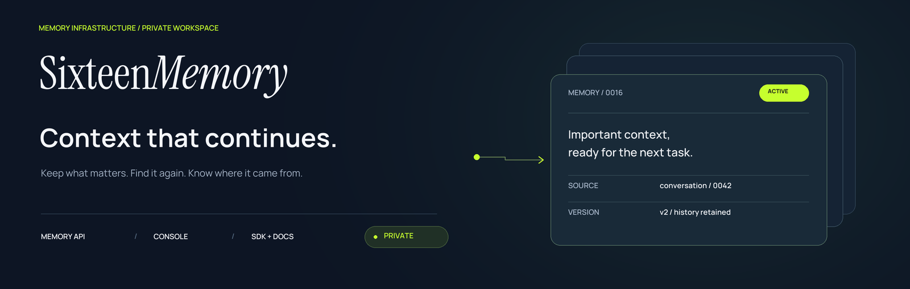

<p align="center">
  
</p>

<h1 align="center">SixteenMemory · 拾陆记忆</h1>

<p align="center">
  <strong>让 Agent 记得，让记忆延续。</strong><br>
  为已有 Agent 提供可管理的长期记忆：保存上下文，找到相关信息，追溯每一次变化。
</p>

<p align="center">
  <a href="docs/QUICKSTART.md">快速开始</a> ·
  <a href="docs/ARCHITECTURE.md">系统架构</a> ·
  <a href="docs/REPOSITORY_MAP.md">代码导航</a> ·
  <a href="docs/ROADMAP.md">开发状态</a> ·
  <a href="CONTRIBUTING.md">参与协作</a>
</p>

---

> **Private · Developer preview**<br>
> 这是 `Sixteen-Memory/sixteen-memory` 的公司私有主仓库，不是开源发布。
> 产品、官网和 SDK 源码均已纳入版本管理；GitHub 推送不会自动部署服务。

## 一层记忆，三部分产品

| Memory API | Console | Developer experience |
| :--- | :--- | :--- |
| 显式写入、范围检索、版本历史与删除 | 查看记忆、来源、Key 与请求记录 | JavaScript SDK、接入示例、文档与官网 |
| [查看服务核心 →](product/worker/) | [查看管理台 →](product/src/) | [查看 SDK →](product/sdk/) · [查看官网 →](homepage/) |

**保留来处。** 记忆与来源一起保存，更新保留历史，业务结果不能由助手的表述替代。<br>
**守住范围。** 服务端检查用户范围和 Key 权限，不依赖客户端隐藏按钮。<br>
**明确变化。** 更新带版本号，停用退出检索，删除清理在线数据与索引。<br>
**渐进接入。** 先使用不调用模型的显式写入与词法检索，再按需启用开发中的智能路径。

## 快速开始

需要 **Node.js 24 + npm**。在仓库根目录安装两个应用的依赖：

```sh
npm run setup
```

**启动官网**

```sh
npm run dev:website -- --port 4180
# http://127.0.0.1:4180
```

**启动产品** — 在另一个终端运行：

```sh
npm run prepare:product
npm run build:product
npm run dev:product
# 管理台 http://127.0.0.1:4191 · API http://127.0.0.1:8790
```

本地管理员 Key 由脚本生成在被 Git 忽略的 `product/.dev.vars` 中。
不要把 Key 粘贴到代码、Issue 或截图里。模型默认关闭；上述构建只做本地 dry-run。

完整说明见 [本地开发指南](docs/QUICKSTART.md)，接口入口见 [文档导航](docs/README.md)。

## 把记忆接进你的应用

SDK 是本仓库的源码模块，**尚未发布 npm 包**。以下代码在仓库根目录的 Node.js 模块中运行，
使用已绑定用户范围的测试 Key；只保存和检索一条合成记录，不调用模型：

```js
import { SixteenMemory } from "./product/sdk/index.mjs";

const memory = new SixteenMemory({
  baseUrl: process.env.SIXTEEN_BASE_URL ?? "http://127.0.0.1:8790",
  apiKey: process.env.SIXTEEN_API_KEY,
});
const userId = process.env.SIXTEEN_USER_ID;
if (!userId || !process.env.SIXTEEN_API_KEY) {
  throw new Error("Set a test key and its allowed user scope.");
}

await memory.add({
  request_id: "readme-synthetic-preference-1",
  user_id: userId,
  content: "用户希望用中文沟通。",
  source: {
    type: "conversation",
    ref: "synthetic-session-1",
    text: "请用中文和我沟通。",
    observed_at: "2026-11-06T08:00:00Z",
  },
  expires_at: null,
});

const result = await memory.search({
  user_id: userId,
  query: "中文 沟通",
  limit: 5,
});
```

相同请求 ID 用于重试同一份内容，不应拿来保存不同内容。
需要完整的更新、历史与清理流程，参见 [客服接续示例](product/examples/)。

## 系统架构

<p align="center">
  
</p>

核心分层是 **接口 → 编排与规则 → 存储／供应商**。
目前数据层使用 SQLite Durable Object，没有引入独立向量数据库或图数据库。
模型调用不在数据库事务内执行，写入提交前再次检查权限和数据状态。

参考 Mem0 将记忆核心、供应商、客户端、服务、示例和评估分开的组织思路；
我们保留现有运行路径，不为了目录形式增加空模块或重写产品。
详见 [架构说明](docs/ARCHITECTURE.md) 与 [Mem0 参考记录](docs/MEM0_LEARNINGS_2026-11-06.md)。

## 代码地图

```text
sixteen-memory/
├── product/                 产品服务与管理台
│   ├── worker/              API、领域规则、存储与模型适配
│   ├── src/                 React 管理台
│   ├── sdk/                 无运行时依赖的 JavaScript 客户端
│   ├── examples/            合成数据接入示例
│   ├── test/                本地行为与迁移检查
│   ├── eval/                单独授权的模型评估工具
│   └── pages/               生产入口与 Service Binding
├── homepage/                独立官网、产品页与开发文档
├── docs/                    架构、开发指南、状态与研究记录
├── scripts/                 仓库级维护工具
└── .github/                 协作模板与负责人说明
```

每个应用独立维护依赖锁文件。先读 [代码导航](docs/REPOSITORY_MAP.md)，再进入需要修改的模块；
后续协作以本仓库为唯一代码来源，不继续维护旧工作区的重复副本。

## 能力与边界

以下是仓库记录的状态快照，不是实时服务监控。生产记录为 **v0.1.0**，
本仓库开发版本为 **v0.2.1**；推送代码不代表新版后端已经发布。

| 状态 | 能力 |
| :--- | :--- |
| **基础已实现 · 记录为线上可用** | 显式记忆生命周期、词法检索、用户范围 Key、控制台、SDK 源码 |
| **开发版本 · 未作为线上能力发布** | 对话抽取与审核、事实槽位、元数据／时间筛选、千问语义与混合检索 |
| **规划中 · 尚未提供** | 用户画像、MCP、OpenAPI、SDK 发布包、Webhook、组织成员与自助计费 |

真实模型效果、客户指标、生产容量与恢复演练没有因为代码入库而得到验证。
详见 [开发状态与下一步](docs/ROADMAP.md)。

## 开发与协作

```sh
npm run check:docs       # 文档链接、资源与能力来源路径；无网络
npm run build:website    # 静态网站构建，不上线
npm run build:product    # 类型检查、前端构建与 Worker dry-run
```

- **组织持有代码，个人账号提交。** 日常协作账号为 `Chengyuann`，使用功能分支和 Pull Request。
- **默认不产生外部副作用。** 不自动部署，不启用真实模型评估，也不改变仓库可见性。
- **私有也要排除秘密。** 凭证、数据库、运行日志和客户数据不进入 Git。
- **开源另建仓库。** 本仓库没有开源许可；第三方依赖和字体继续适用各自许可。

[协作指南](CONTRIBUTING.md) · [安全说明](SECURITY.md) · [仓库归属](docs/GITHUB_REPOSITORY_PLAN.md)
