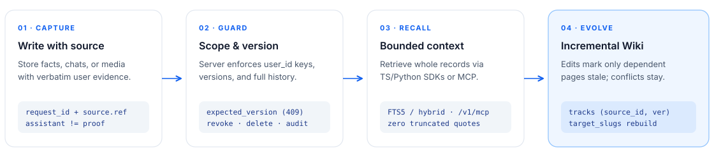

<p align="center">
  <picture>
    <source media="(prefers-color-scheme: dark)" srcset="docs/assets/hero-lockup-dark.png">
    <source media="(prefers-color-scheme: light)" srcset="docs/assets/hero-lockup-light.png">
    
  </picture>
</p>

<p align="center">
  <strong>Source-linked memory infrastructure for AI Agents.</strong><br>
  Keep what matters, trace every claim to verbatim evidence, and evolve knowledge incrementally on SQLite.
</p>

<p align="center">
  <a href="https://www.sixteenmemory.com/?lang=en">Website</a> ·
  <a href="docs/QUICKSTART.md">Quickstart</a> ·
  <a href="docs/ARCHITECTURE.md">Architecture</a> ·
  <a href="https://github.com/Sixteen-Memory/sixteen-memory/releases/tag/v0.3.0">Releases</a> ·
  <a href="https://github.com/Sixteen-Memory/sixteen-memory/discussions">Discussions</a>
</p>

<p align="center">
  <a href="https://github.com/Sixteen-Memory/sixteen-memory/releases/tag/v0.3.0"></a>
  <a href="LICENSE"></a>
  <a href="product/worker/"></a>
  <a href="product/integrations/code-agents/README.md"></a>
</p>

<p align="center">
  <strong>English</strong> · <a href="README.zh-CN.md">简体中文</a>
</p>

---

Your AI agent should never guess where a memory came from—or silently keep serving stale knowledge after facts change.

**SixteenMemory** is an open-source memory and knowledge engine for AI Agents. It runs directly on Cloudflare Workers and SQLite Durable Objects with built-in FTS5 retrieval, pairing every stored memory with verbatim source evidence, optimistic version history, server-enforced user isolation, and incremental source-linked Wiki pages.

| | |
| :--- | :--- |
| **Source-linked provenance** | Every record stores verbatim user evidence (`conversation`, `manual`, or reviewed media) and an idempotent `request_id`. Assistant claims never prove a business action occurred. |
| **Server-enforced scope &amp; versions** | `user_id` isolation, read-only vs. read/write API keys, and OAuth PKCE grants are enforced in the Worker. Mutations require `expected_version` and preserve full audit history. |
| **Incremental source-linked Wiki** | Derived knowledge pages track exact `(source_id, version)` dependencies. Editing or deleting a source marks only dependent pages stale and keeps multi-source conflicts visible for review. |
| **Native MCP &amp; Code Agents** | Connect **Codex** and **Claude Code** directly to `/v1/mcp` using scoped read-only keys or browser-approved PKCE OAuth writes—no local daemon or proxy required. |
| **Zero-DB footprint** | Runs 100% locally or on Cloudflare Workers + SQLite Durable Objects with built-in FTS5—no external vector database, graph server, or paid LLM key needed to start. |
| **Opt-in intelligence** | Model-driven extraction, fact-slot review, Qwen semantic/hybrid RRF retrieval, and 30-minute chunked audio/video ingestion stay disabled until explicitly configured. |

<p align="center">
  <picture>
    <source media="(prefers-color-scheme: dark)" srcset="docs/assets/lifecycle-dark.svg">
    <source media="(prefers-color-scheme: light)" srcset="docs/assets/lifecycle-light.svg">
    
  </picture>
</p>

---

## Give your Agent memory

### 1. Run the service locally (60 seconds, zero API keys)

Requires **Node.js 24+** and **npm**:

```sh
git clone https://github.com/Sixteen-Memory/sixteen-memory.git
cd sixteen-memory
npm run setup
npm run prepare:product && npm run build:product && npm run dev:product
```

- **API**: `http://127.0.0.1:8790` (`GET /health`)
- **Console**: `http://127.0.0.1:4191` (local admin key generated in Git-ignored `product/.dev.vars`)

Want to see the full authenticated HTTP + streaming chat loop against real local SQLite storage with zero external credentials?

```sh
npm run example:integration
```

### 2. Connect with TypeScript, Python, MCP, or Vercel AI SDK

All client packages are available directly from **[Release v0.3.0](https://github.com/Sixteen-Memory/sixteen-memory/releases/tag/v0.3.0)** (zero-dependency ESM TypeScript/JS, dependency-free Python sync + optional `httpx` async).

#### TypeScript / JavaScript

```sh
npm install https://github.com/Sixteen-Memory/sixteen-memory/releases/download/v0.3.0/sixteen-memory-sdk-0.3.0.tgz
```

```ts
import { SixteenMemory } from "@sixteen-memory/sdk";

const memory = new SixteenMemory({
  baseUrl: process.env.SIXTEEN_BASE_URL ?? "http://127.0.0.1:8790",
  apiKey: process.env.SIXTEEN_API_KEY, // user-scoped key created in the console
});

const saved = await memory.add({
  request_id: "pref-concise-replies-001",
  user_id: process.env.SIXTEEN_USER_ID!,
  content: "Prefers concise technical summaries with file links.",
  source: {
    type: "conversation",
    ref: "session-42",
    text: "Please keep technical summaries concise and link the files.",
    observed_at: "2026-11-25T08:00:00Z",
  },
});

const matches = await memory.search({ user_id: saved.user_id, query: "concise summaries" });
```

#### Python (sync &amp; native `asyncio`)

```sh
python -m pip install https://github.com/Sixteen-Memory/sixteen-memory/releases/download/v0.3.0/sixteen_memory-0.3.1-py3-none-any.whl
```

```python
import os
from sixteen_memory import SixteenMemory

client = SixteenMemory(os.environ["SIXTEEN_BASE_URL"], os.environ["SIXTEEN_API_KEY"])
user_id = os.environ["SIXTEEN_USER_ID"]

client.add(
    user_id=user_id,
    request_id="py-ci-pref-001",
    content="Uses Python 3.12 and ruff in CI.",
    source={
        "type": "conversation",
        "ref": "session-99",
        "text": "Our CI pipeline runs Python 3.12 with ruff.",
        "observed_at": "2026-11-25T08:00:00Z",
    },
)
results = client.search(user_id, "Python CI")
```

#### Codex &amp; Claude Code (MCP)

```sh
# Print ready-to-paste MCP config referencing SIXTEEN_MEMORY_API_KEY (never embeds raw keys)
npm --prefix product run agents -- config codex --base-url http://127.0.0.1:8790
npm --prefix product run agents -- config claude-code --base-url http://127.0.0.1:8790

# Verify MCP capability negotiation and tool schemas without reading user data
npm --prefix product run agents -- check --base-url http://127.0.0.1:8790
```

#### Vercel AI SDK 7

```ts
import { generateText } from "ai";
import { createSixteenMemory } from "@sixteen-memory/vercel-ai";

const memory = createSixteenMemory({
  baseUrl: process.env.SIXTEEN_BASE_URL!,
  apiKey: scopedUserKey,
  userId: authenticatedUser.id,
});

const { text } = await generateText({
  model: memory.withMemory(approvedModel), // scoped retrieval middleware; model tools stay read-only
  prompt: "How should we structure our CI checks?",
  maxRetries: 0,
});
```

---

## Architecture

<p align="center">
  <picture>
    <source media="(prefers-color-scheme: dark)" srcset="docs/assets/architecture-dark.svg">
    <source media="(prefers-color-scheme: light)" srcset="docs/assets/architecture-light.svg">
    
  </picture>
</p>

- **Single-storage simplicity**: Memories, verbatim sources, version history, FTS5 indexes, conversations, Wiki source dependencies, and OAuth/key digests live inside one SQLite Durable Object.
- **No network calls inside transactions**: Opt-in embedding, extraction, and 30-minute chunked media jobs run outside SQLite transactions and re-verify `expected_version` and scope before committing.
- **Clean-room design**: Informed by architectural lessons from Mem0 and Anthropic's knowledge-Wiki pattern without vendoring third-party code or prompts. Read [Architecture](docs/ARCHITECTURE.md) and [v0.3 comparison](docs/MEMORY_COMPARISON_V030.md).

## Design tradeoffs

| Dimension | Generic vector-only memory | SixteenMemory |
| :--- | :--- | :--- |
| **Provenance** | Summarized text often detached from original utterance | Verbatim source evidence required on every record and version |
| **Updates &amp; conflicts** | Silent overwrites or duplicate chunks | `expected_version` guard, full history, conflicts preserved for review |
| **Derived knowledge** | Full re-summarization or stale cached notes | [Incremental Wiki](product/INCREMENTAL_WIKI_2026-11-23.md) invalidates only source-dependent pages |
| **Infrastructure** | Postgres / Qdrant / Neo4j / Redis stack | Single Cloudflare Worker + SQLite Durable Object |
| **Model dependency** | Required on every write and search | Model-free FTS5 baseline; LLM/embeddings/media are strictly opt-in |

## Monorepo map

| Module | Path | Documentation |
| :--- | :--- | :--- |
| **Memory &amp; Knowledge Worker** | [`product/worker/`](product/worker/) | [Service notes](product/worker/README.md) · [Incremental Wiki](product/INCREMENTAL_WIKI_2026-11-23.md) · [Context &amp; Evidence](product/MEMORY_COMPONENTS.md) |
| **Management Console** | [`product/src/`](product/src/) | [Product guide](product/README.md) · [Deployment](product/DEPLOYMENT.md) |
| **TypeScript / JS SDK** | [`product/sdk/`](product/sdk/) | [SDK guide](product/sdk/README.md) · [OpenAPI 3.1](product/openapi/README.md) |
| **Python SDK** | [`product/sdk-python/`](product/sdk-python/) | [Python guide](product/sdk-python/README.md) · [Examples](product/examples/README.md) |
| **Vercel AI SDK 7 Adapter** | [`product/integrations/vercel-ai/`](product/integrations/vercel-ai/) | [Adapter guide](product/integrations/vercel-ai/README.md) |
| **MCP &amp; Code Agents** | [`product/integrations/code-agents/`](product/integrations/code-agents/) | [Code Agent setup](product/integrations/code-agents/README.md) · [MCP OAuth](product/MCP_OAUTH_RELEASE_2026-11-09.md) |
| **Media Ingestion &amp; Evals** | [`product/eval/`](product/eval/) | [30-min media guide](product/ANYTHING_TO_MEMORY.md) · [Provider policy](product/PROVIDER_POLICY.md) |
| **Website &amp; Docs Portal** | [`homepage/`](homepage/) · [`docs/`](docs/) | [Quickstart](docs/QUICKSTART.md) · [Code map](docs/REPOSITORY_MAP.md) · [Roadmap](docs/ROADMAP.md) |

## Verification &amp; contributing

```sh
npm run check:docs        # Offline link, SVG safety, capability evidence, and prose checks
npm run check:api         # OpenAPI 3.1 schema, SDK types, and clean archive install
npm run build:product     # TypeScript, console bundle, and Worker dry run
npm run check:product     # 49 unit and local Worker/SQLite behavior tests
npm run check:vercel-ai   # Adapter types and 25 offline middleware/tool/handler tests
npm run check:website     # 43 bilingual site checks and static route build
```

Pushing code never triggers hosted deployments, database migrations, or paid model calls. See [Contributing](CONTRIBUTING.md), [Security](SECURITY.md), [Repository governance](docs/GITHUB_REPOSITORY_PLAN.md), and [Third-party licenses](product/THIRD_PARTY_LICENSES.md).

Licensed under **[Apache License 2.0](LICENSE)**.
