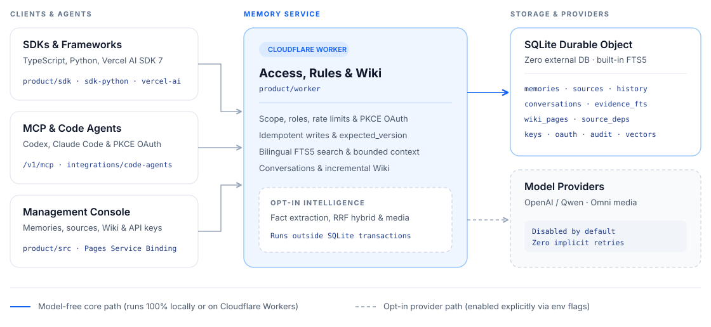

<p align="center">
  
</p>

<h1 align="center">SixteenMemory</h1>

<p align="center">
  <strong>Memory your Agent can use. Context that continues.</strong><br>
  A managed memory layer for existing Agents: keep important context, retrieve what matters, and trace every change.
</p>

<p align="center">
  <a href="docs/QUICKSTART.md">Quickstart</a> ·
  <a href="docs/ARCHITECTURE.md">Architecture</a> ·
  <a href="docs/REPOSITORY_MAP.md">Code map</a> ·
  <a href="docs/ROADMAP.md">Roadmap</a> ·
  <a href="CONTRIBUTING.md">Contributing</a>
</p>

---

> **Private · Developer preview**<br>
> `Sixteen-Memory/sixteen-memory` is the company's private source repository, not an open-source release.
> It contains the product, website, and SDK. Pushing code does not deploy a service.

## One memory layer. Three product surfaces.

| Memory API | Console | Developer experience |
| :--- | :--- | :--- |
| Explicit writes, scoped retrieval, version history, and deletion | Inspect memories, sources, keys, and request records | JavaScript SDK, Vercel AI SDK adapter, examples, documentation, and website |
| [Explore the service →](product/worker/) | [Explore the console →](product/src/) | [Explore the SDK →](product/sdk/) · [AI SDK adapter →](product/integrations/vercel-ai/) · [Explore the website →](homepage/) |

**Keep the source.** Store evidence with each memory and preserve history when it changes. An assistant's statement does not prove a business action occurred.<br>
**Respect the scope.** Enforce user boundaries and key permissions on the server, not through hidden interface controls.<br>
**Make changes explicit.** Update with a version, deactivate to exclude from retrieval, and delete online data and indexes.<br>
**Integrate incrementally.** Start with explicit writes and lexical retrieval, without model calls. Enable development-stage intelligent paths only when needed.

## Quickstart

Requires **Node.js 24 + npm**. Install both applications from the repository root:

```sh
npm run setup
```

**Start the website**

```sh
npm run dev:website -- --port 4180
# http://127.0.0.1:4180
```

**Start the product** in another terminal:

```sh
npm run prepare:product
npm run build:product
npm run dev:product
# Console http://127.0.0.1:4191 · API http://127.0.0.1:8790
```

The preparation script generates a local administrator key in the Git-ignored `product/.dev.vars` file.
Never paste it into source code, issues, or screenshots. Models are disabled by default; the product build performs a local dry run only.

Read the [local development guide](docs/QUICKSTART.md) or browse the [documentation index](docs/README.md).

## Add memory to your application

The [typed SDK](product/sdk/README.md) is available as a website download, **not an npm registry release**. Its types come from the [OpenAPI specification](product/openapi/README.md). The original source import below remains compatible. Run it in a Node.js module at the repository root with a test key and its permitted user scope. It stores and retrieves one synthetic record without calling a model:

```js
import { SixteenMemory } from "./product/sdk/index.mjs";

const memory = new SixteenMemory({
  baseUrl: process.env.SIXTEEN_BASE_URL ?? "http://127.0.0.1:8790",
  apiKey: process.env.SIXTEEN_API_KEY,
});
const userId = process.env.SIXTEEN_USER_ID;
if (!userId || !process.env.SIXTEEN_API_KEY) {
  throw new Error("Set a test key and its allowed user scope.");
}

await memory.add({
  request_id: "readme-synthetic-english-preference-1",
  user_id: userId,
  content: "The user prefers to communicate in English.",
  source: {
    type: "conversation",
    ref: "synthetic-session-1",
    text: "Please communicate with me in English.",
    observed_at: "2026-11-06T08:00:00Z",
  },
  expires_at: null,
});

const result = await memory.search({
  user_id: userId,
  query: "English communicate",
  limit: 5,
});
```

Reuse a request ID only when retrying the same content, not for a different write. See the [customer continuity example](product/examples/) for updates, history, and cleanup.

## Architecture

<p align="center">
  
</p>

The core layers are **access → orchestration and rules → storage and providers**.
Storage uses a SQLite Durable Object, without a separate vector or graph database. Model calls run outside database transactions; final writes recheck permissions and data state.

Mem0's separation of memory, providers, clients, services, examples, and evaluation informs the repository organization. We retain the working runtime paths rather than add empty modules or rewrite the product for appearances.
See the [architecture guide](docs/ARCHITECTURE.md) and [Mem0 research notes](docs/MEM0_LEARNINGS_2026-11-06.md).

## Code map

```text
sixteen-memory/
├── product/                 Product service and console
│   ├── worker/              API, domain rules, storage, and model adapters
│   ├── src/                 React management console
│   ├── sdk/                 JavaScript client with no runtime dependencies
│   ├── examples/            Synthetic integration examples
│   ├── integrations/        Framework adapters with isolated dependency locks
│   ├── test/                Local behavior and migration checks
│   ├── eval/                Separately authorized model evaluation
│   └── pages/               Production entry and Service Binding
├── homepage/                Independent website and developer documentation
├── docs/                    Architecture, guides, status, and research
├── scripts/                 Repository maintenance tools
└── .github/                 Collaboration templates and ownership
```

Each application maintains its own dependency lockfile. Start with the [code map](docs/REPOSITORY_MAP.md), then open the relevant module. This repository is the source of truth; do not continue developing duplicate copies in the old workspace.

## Capabilities and boundaries

This is a recorded status snapshot, not live monitoring. The recorded production baseline is **v0.1.0**; the development version is **v0.2.1**. A code push does not publish a new backend version.

| Status | Capabilities |
| :--- | :--- |
| **Implemented baseline · recorded as live** | Explicit memory lifecycle, lexical retrieval, user-scoped keys, console, OpenAPI 3.1, and typed SDK download |
| **Development · not released as live features** | Private Vercel AI SDK adapter; conversation extraction and review, fact slots, metadata and time filters, Qwen semantic and hybrid retrieval |
| **Planned · not available** | Profiles, MCP, npm registry and Python SDK releases, webhooks, organization members, and self-service billing |

Committing code does not validate real-model quality, customer outcomes, production capacity, or recovery procedures. Read the [roadmap and current status](docs/ROADMAP.md).

## Development and collaboration

```sh
npm run check:docs       # Offline documentation, language, asset, and evidence checks
npm run build:website    # Static build; no publication
npm run build:product    # Type checks, frontend build, and Worker dry run
```

- **Company ownership, personal contributions.** `Chengyuann` contributes through feature branches and pull requests.
- **English repository documentation.** Keep guides, templates, and new contribution descriptions in English. Product localization and multilingual test data remain separate.
- **No automatic external changes.** Do not deploy, run paid model evaluation, or change repository visibility implicitly.
- **Private does not mean secret-safe.** Keep credentials, databases, logs, and customer data out of Git.
- **Open source belongs in a separate repository.** This repository has no open-source license. Third-party dependencies and fonts retain their own licenses.

[Contributing](CONTRIBUTING.md) · [Security](SECURITY.md) · [Repository ownership](docs/GITHUB_REPOSITORY_PLAN.md)
