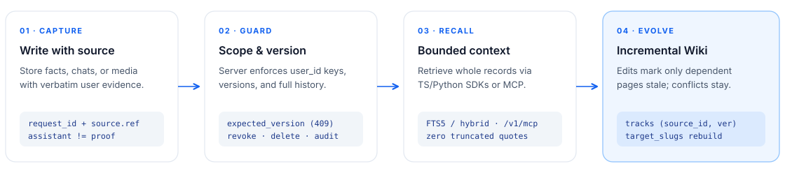
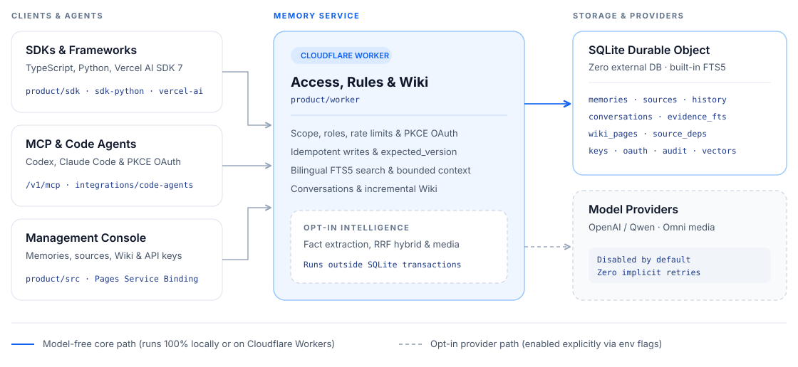

<p align="center">
  <picture>
    <source media="(prefers-color-scheme: dark)" srcset="docs/assets/hero-lockup-dark.png">
    <source media="(prefers-color-scheme: light)" srcset="docs/assets/hero-lockup-light.png">
    
  </picture>
</p>

<p align="center">
  <strong>面向 AI Agent 的来源可追溯记忆基础设施。</strong><br>
  留住关键上下文，为每一条主张保留原始证据，在 SQLite 上实现增量更新的知识记忆层。
</p>

<p align="center">
  <a href="https://www.sixteenmemory.com/">官方网站</a> ·
  <a href="docs/QUICKSTART.md">快速开始</a> ·
  <a href="docs/ARCHITECTURE.md">系统架构</a> ·
  <a href="https://github.com/Sixteen-Memory/sixteen-memory/releases/tag/v0.3.0">版本发布</a> ·
  <a href="https://github.com/Sixteen-Memory/sixteen-memory/discussions">社区讨论</a>
</p>

<p align="center">
  <a href="https://github.com/Sixteen-Memory/sixteen-memory/actions/workflows/ci.yml"></a>
  <a href="https://github.com/Sixteen-Memory/sixteen-memory/releases/tag/v0.3.0"></a>
  <a href="LICENSE"></a>
  <a href="product/worker/"></a>
  <a href="product/integrations/code-agents/README.md"></a>
</p>

<p align="center">
  <a href="README.md">English</a> · <strong>简体中文</strong>
</p>

---

AI Agent 不应该猜测一条记忆从哪里来，更不应该在事实变化后继续静默注入过期结论。

**SixteenMemory** 是面向 AI Agent 的开源记忆与知识引擎，直接运行在 Cloudflare Workers 与 SQLite Durable Objects 之上：无需额外部署向量库或图数据库，开箱即可获得原文来源留痕、乐观并发版本历史、服务端用户隔离，以及按来源依赖增量更新的 Wiki 知识页。

| | |
| :--- | :--- |
| **来源可追溯** | 每条记忆都绑定原始用户证据（对话、手动录入或经审核的音视频）与幂等 `request_id`，助手单方面的表述不能替代真实业务事实。 |
| **服务端隔离与版本控制** | `user_id` 边界、只读/读写 Key 与 OAuth PKCE 授权全部由 Worker 强制校验；更新必须携带 `expected_version` 并保留完整历史。 |
| **增量来源关联 Wiki** | 衍生知识页精确记录 `(source_id, version)` 依赖；来源变更仅使关联页面失效，绝不返回过期主张，多方冲突保留双方来源等待人工确认。 |
| **原生 MCP 与 Code Agent** | 支持 **Codex** 与 **Claude Code** 直连 `/v1/mcp`，提供只读用户 Key 与浏览器确认的 PKCE OAuth 写入，无需本地常驻守护进程。 |
| **零外部数据库启动** | 基于单节点 SQLite Durable Object 与内置 FTS5 词法检索，本地或 Cloudflare 上均可零模型 Key 立即运行。 |
| **按需启用模型能力** | 对话事实提取、槽位审核、通义千问语义/混合 RRF 检索与 30 分钟音视频分片审核默认关闭，仅在显式配置后启用。 |

<p align="center">
  <picture>
    <source media="(prefers-color-scheme: dark)" srcset="docs/assets/lifecycle-dark.svg">
    <source media="(prefers-color-scheme: light)" srcset="docs/assets/lifecycle-light.svg">
    
  </picture>
</p>

---

## 60 秒接入你的 Agent

### 1. 本地启动完整服务（无需任何模型 API Key）

需要 **Node.js 24+** 与 **npm**：

```sh
git clone https://github.com/Sixteen-Memory/sixteen-memory.git
cd sixteen-memory
npm run setup:product
npm run quickstart
```

- **记忆 API**：`http://127.0.0.1:8790`（健康检查 `GET /health`）
- **中英双语控制台**：`http://127.0.0.1:4191`（本地 `ADMIN_KEY` 自动写入 Git 忽略的 `product/.dev.vars`，按需接入 OpenAI / 通义千问可参考 [`product/.dev.vars.example`](product/.dev.vars.example)）

5 秒零密钥运行完整的“来源记忆 → 增量 Wiki 精确失效 → 冲突保留 → 真实 MCP 读取”端到端演示：

```sh
npm run build:product && npm run demo
```

### 2. 通过 TypeScript、Python、MCP 或 Vercel AI SDK 接入

所有客户端构建包均已随 **[Release v0.3.0](https://github.com/Sixteen-Memory/sixteen-memory/releases/tag/v0.3.0)** 发布，可直接安装使用。

#### TypeScript / JavaScript

```sh
npm install https://github.com/Sixteen-Memory/sixteen-memory/releases/download/v0.3.0/sixteen-memory-sdk-0.3.0.tgz
```

```ts
import { SixteenMemory } from "@sixteen-memory/sdk";

const memory = new SixteenMemory({
  baseUrl: process.env.SIXTEEN_BASE_URL ?? "http://127.0.0.1:8790",
  apiKey: process.env.SIXTEEN_API_KEY, // 在控制台创建的用户作用域 Key
});

const saved = await memory.add({
  request_id: "pref-concise-replies-001",
  user_id: process.env.SIXTEEN_USER_ID!,
  content: "偏好简洁的技术结论，并附带文件路径链接。",
  source: {
    type: "conversation",
    ref: "session-42",
    text: "请保持技术总结简洁，并附上相关文件链接。",
    observed_at: "2026-11-25T08:00:00Z",
  },
});

const matches = await memory.search({ user_id: saved.user_id, query: "简洁 技术" });
```

#### Python（同步 + 原生 `asyncio`）

```sh
python -m pip install https://github.com/Sixteen-Memory/sixteen-memory/releases/download/v0.3.0/sixteen_memory-0.3.1-py3-none-any.whl
```

```python
import os
from sixteen_memory import SixteenMemory

client = SixteenMemory(os.environ["SIXTEEN_BASE_URL"], os.environ["SIXTEEN_API_KEY"])
user_id = os.environ["SIXTEEN_USER_ID"]

client.add(
    user_id=user_id,
    request_id="py-ci-pref-001",
    content="CI 流水线使用 Python 3.12 与 ruff。",
    source={
        "type": "conversation",
        "ref": "session-99",
        "text": "我们项目的 CI 使用 Python 3.12 和 ruff。",
        "observed_at": "2026-11-25T08:00:00Z",
    },
)
results = client.search(user_id, "Python CI")
```

#### Codex 与 Claude Code（MCP）

```sh
# 输出可直接粘贴的 MCP 配置（仅引用环境变量 SIXTEEN_MEMORY_API_KEY，绝不写入明文密钥）
npm --prefix product run agents -- config codex --base-url http://127.0.0.1:8790
npm --prefix product run agents -- config claude-code --base-url http://127.0.0.1:8790

# 仅检查连接与工具能力，不读取任何用户记忆数据
npm --prefix product run agents -- check --base-url http://127.0.0.1:8790
```

#### Vercel AI SDK 7

```ts
import { generateText } from "ai";
import { createSixteenMemory } from "@sixteen-memory/vercel-ai";

const memory = createSixteenMemory({
  baseUrl: process.env.SIXTEEN_BASE_URL!,
  apiKey: scopedUserKey,
  userId: authenticatedUser.id,
});

const { text } = await generateText({
  model: memory.withMemory(approvedModel), // 作用域检索中间件，模型工具保持只读
  prompt: "我们的 CI 检查应该怎么组织？",
  maxRetries: 0,
});
```

---

## 系统架构

<p align="center">
  <picture>
    <source media="(prefers-color-scheme: dark)" srcset="docs/assets/architecture-dark.svg">
    <source media="(prefers-color-scheme: light)" srcset="docs/assets/architecture-light.svg">
    
  </picture>
</p>

- **单一存储极简运维**：记忆、原文来源、版本历史、FTS5 索引、完整对话、Wiki 来源依赖及 OAuth/Key 摘要全部存储在单个 SQLite Durable Object 中。
- **事务内绝不等待网络模型**：按需开启的向量计算、事实提取与 30 分钟音视频分片任务均在 SQLite 事务外执行，最终落库前重新核对版本号与权限边界。
- **独立干净实现**：吸收了 Mem0 与 Anthropic 知识 Wiki 模式的工程经验，未拷贝任何第三方源码或提示词。详见 [系统架构](docs/ARCHITECTURE.md) 与 [v0.3 方案对比](docs/MEMORY_COMPARISON_V030.md)。

## 设计取舍对比

| 维度 | 常见纯向量记忆层 | SixteenMemory |
| :--- | :--- | :--- |
| **来源留痕** | 摘要片段常与原始对话脱节 | 每条记录和版本强制绑定原始证据 |
| **更新与冲突** | 静默覆盖或产生重复片段 | `expected_version` 并发保护、保留完整历史与多方冲突 |
| **衍生知识页** | 全量重算或返回过期缓存 | [增量 Wiki](product/INCREMENTAL_WIKI_2026-11-23.md) 仅让依赖变更来源的页面失效 |
| **部署复杂度** | Postgres + 向量库 + 图库 + 缓存 | 单 Cloudflare Worker + SQLite Durable Object |
| **模型依赖** | 每次写入和检索都强依赖大模型 | 零模型 FTS5 开箱可用，LLM / 向量 / 音视频按需开启 |

## 仓库模块导航

| 模块 | 目录 | 说明文档 |
| :--- | :--- | :--- |
| **记忆与知识服务** | [`product/worker/`](product/worker/) | [服务说明](product/worker/README.md) · [增量 Wiki](product/INCREMENTAL_WIKI_2026-11-23.md) · [证据与上下文](product/MEMORY_COMPONENTS.md) |
| **React 管理控制台** | [`product/src/`](product/src/) | [产品指南](product/README.md) · [部署说明](product/DEPLOYMENT.md) |
| **TypeScript / JS SDK** | [`product/sdk/`](product/sdk/) | [SDK 指南](product/sdk/README.md) · [OpenAPI 3.1](product/openapi/README.md) |
| **Python SDK** | [`product/sdk-python/`](product/sdk-python/) | [Python 指南](product/sdk-python/README.md) · [示例代码](product/examples/README.md) |
| **Vercel AI SDK 7 适配器** | [`product/integrations/vercel-ai/`](product/integrations/vercel-ai/) | [适配器文档](product/integrations/vercel-ai/README.md) |
| **MCP 与 Code Agent** | [`product/integrations/code-agents/`](product/integrations/code-agents/) | [接入指南](product/integrations/code-agents/README.md) · [MCP OAuth](product/MCP_OAUTH_RELEASE_2026-11-09.md) |
| **音视频入库与评估** | [`product/eval/`](product/eval/) | [30 分钟音视频说明](product/ANYTHING_TO_MEMORY.md) · [模型策略](product/PROVIDER_POLICY.md) |
| **官网与文档门户** | [`homepage/`](homepage/) · [`docs/`](docs/) | [本地开发](docs/QUICKSTART.md) · [代码地图](docs/REPOSITORY_MAP.md) · [路线图](docs/ROADMAP.md) |

## 本地验证与参与贡献

```sh
npm run check:docs        # 离线链接、SVG 安全、能力证据与文档语言校验
npm run check:api         # OpenAPI 3.1 规范、SDK 类型与离线打包安装检查
npm run build:product     # TypeScript、控制台打包与 Worker 演练构建
npm run check:product     # 49 项单元与本地 Worker/SQLite 行为测试
npm run check:vercel-ai   # 适配器类型与 25 项中间件/工具/路由离线测试
npm run check:website     # 43 项双语官网检查与静态路由构建
```

欢迎通过 Issue、Discussion 与 Pull Request 参与贡献，详情请参阅 [贡献指南](CONTRIBUTING.md)、[安全说明](SECURITY.md) 与 [仓库治理](docs/GITHUB_REPOSITORY_PLAN.md)。

本项目基于 **[Apache License 2.0](LICENSE)** 开源。
