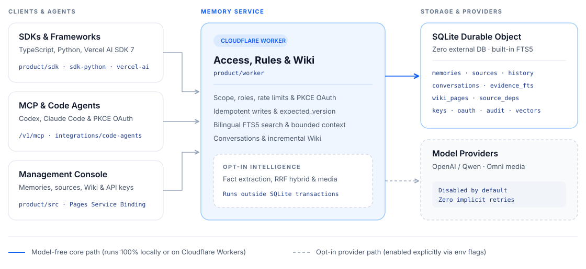

# Architecture

**Give writes, changes, retrieval, and management clear responsibilities.**

[Documentation](README.md) · [Code map](REPOSITORY_MAP.md) · [Roadmap](ROADMAP.md)



## Design boundaries

SixteenMemory provides memory infrastructure, not an Agent's business execution layer. Refunds, shipments, and approvals must be confirmed by the business system. An assistant saying "done" is not proof that an action occurred.

There are two independently buildable and deployable applications, not a collection of microservices:

- `product/`: Worker, SQLite Durable Object, console, and SDK.
- `homepage/`: static website and developer entry points; it does not collect memory content or model credentials.

The data layer depends directly on SQLite Durable Objects. There is no separate vector database, graph database, unified task queue, or general-purpose plugin framework. Planned components are not shown as implemented infrastructure.

## Four responsibilities

| Layer | Implementation | Responsible for | Not responsible for |
| :--- | :--- | :--- | :--- |
| Access | `worker/index.ts`, `src/`, `sdk/` | HTTP, sessions, errors, interface, and client calls | Trusting client parameters to determine ownership |
| Orchestration and rules | `intelligence.ts`, `domain.ts`, fact slots, and filters | Validation, scope checks, extraction/retrieval orchestration, and update semantics | Treating model output as unconditionally trusted input |
| Persistence | `project.ts`, `intelligence-store.ts` | SQLite, indexes, history, review records, and transaction commits | Waiting for model network calls inside a transaction |
| Provider boundary | `providers.ts`, `embedding-config.ts`, `generation-options.ts` | HTTPS calls, response validation, configuration, and index fingerprints | Silent model switching, unlimited retries, or copied production credentials |

Answer generation currently remains in `worker/index.ts`; it has not been fully moved behind a shared provider interface. A future expansion of answer providers can consolidate that code into the adapter layer.

## An explicit write

1. The Worker checks Origin, rate limits, credentials, and request structure.
2. `MemoryProject` validates identity, user scope, capacity, and request ID.
3. If embeddings are configured, vectors are prepared first. The default disabled configuration makes no model call.
4. Persistence repeats the necessary checks at final commit, saving the current record, source, history, and index.
5. Retrying the same content with the same request ID does not create a duplicate. Reusing that ID for different content causes a conflict.

Updates carry `expected_version` to avoid overwriting concurrent changes. These guarantees cover local data commits, not a distributed transaction that can roll back both the provider call and the database.

## A search

```text
user scope + query + filter/at
           |
           +-- lexical ---------- SQLite FTS -> results and sources
           |
           +-- semantic/hybrid -- access and index coverage checks
                                    -> query embedding
                                    -> recheck scope and data state
                                    -> cosine ranking / RRF fusion -> results
```

Lexical retrieval does not require a model. The development semantic path reads a bounded set of vectors from SQLite; it is not a large-scale ANN service. The index fingerprint includes provider, model, dimensions, API style, and revision. Configuration changes require explicit reindexing.

Filters apply before the result limit, and OR/NOT conditions cannot broaden user scope. `at` filters the validity window of the **currently stored version**; it does not reconstruct a historical snapshot.

## Conversation extraction: a development path

`ingest()` orchestrates candidate extraction and memory maintenance. `intelligence-domain.ts` validates evidence, structure, and proposed changes. Clear new facts can enter an update plan; ambiguity, unregistered slots, or untrusted support require review.

- Exact user text is evidence; assistant messages provide context only.
- A model cannot silently overwrite a manual correction.
- Model failure and "no facts extracted" are distinct results.
- Approval still requires checking whether the target data has changed.

This path exists in source, but real-model quality is not yet confirmed. It is not presented as a released production capability.

## Data lifecycle

| Data | Location or purpose |
| :--- | :--- |
| Current memories and sources | `memories`, with user scope, state, and version |
| History | `history`, preserving changes and prior sources |
| Lexical index | SQLite FTS5 for baseline retrieval |
| Keys and sessions | Digests, permissions, expiry, and revocation state; not retrievable plaintext keys |
| Idempotency and request records | Request digests, statuses, durations, and operation identifiers |
| Intelligent-path data | Vectors, ingestions, evidence, review candidates, and usage |

Deactivation and deletion differ: deactivation removes a record from retrieval; deletion clears online records and related data. Platform backups and recovery copies have separate retention boundaries and are not claimed to disappear immediately.

## Pushing is not deploying

Production traffic reaches the Worker through a Pages Service Binding. The local console proxies to a local Worker. Each deployment currently has one fixed project; user-scoped keys are not an enterprise multi-organization identity system.

The GitHub repository is open-source under the [Apache License 2.0](../LICENSE). The website and product build separately and require separate publication approval. There is no automatic deployment workflow.

## Learn from Mem0 without copying it

| Mem0 organization | SixteenMemory equivalent | Our choice |
| :--- | :--- | :--- |
| Memory core | `product/worker/` | Prioritize explicit current records, versions, and sources |
| LLM, embedding, and storage configuration | Worker adapter and configuration files | Avoid unnecessary databases or providers |
| Clients and service | `product/sdk/`, Worker, and console | Keep the existing TypeScript and JavaScript implementation |
| Examples, documentation, and evaluation | `product/examples/`, `docs/`, `product/eval/` | Provide separate entry points; keep paid evaluation out of routine builds |

No Mem0 source, prompts, branding, or benchmark figures were copied. Directories represent real modules; empty `graph/`, `mcp/`, or `integrations/` folders would misleadingly imply implemented features.
